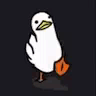

  

<h1 align="center">hey, i'm gui.</h1>

  <strong>C# + Python</strong> 
  game engines, machine learning, games, and ducks.

---

### how i got here

- **2020** — started programming with **Python**.
- **2022** — found **Godot** and got into making games.
- **2025** — picked up **C#** and **C++**. C# stayed. C++ got left on read.

these days, **C# and Python** are my main languages. i like building engines, exploring machine learning, and figuring out how things work by making my own versions.

**Rust** has a suspicious amount of my attention. **JavaScript** and i are not friends.

### things i'm building and exploring

| project | what it is |
| --- | --- |
| [project horizons](https://github.com/gui-bertoso/project-horizons-csharp) | a game project built with C# and Godot. |
| [duck engine](https://github.com/gui-bertoso/duck-engine-python) | a Python/Pygame engine prototype with nodes, scenes, and runtime inspection. |
| [machine learning experiments](https://github.com/gui-bertoso/machine-learning-experiments) | small Python experiments and studies. |
| [maya](https://github.com/gui-bertoso/maya) | a Python desktop assistant for local workflows and automation. |
| [ducktimizer](https://github.com/gui-bertoso/ducktimizer) | a standalone Windows optimizer built with C# and Avalonia. |

some are early experiments, some have grown into much bigger projects. that's usually how it starts.

---

  <a href="https://github.com/gui-bertoso/portfolio">portfolio</a>
  &nbsp;·&nbsp;
  <a href="https://www.instagram.com/gui.bertoso/">instagram</a>
  &nbsp;·&nbsp;
  discord: <code>pato_lizo</code>

  there will probably be a duck in the next project too. 🦆

